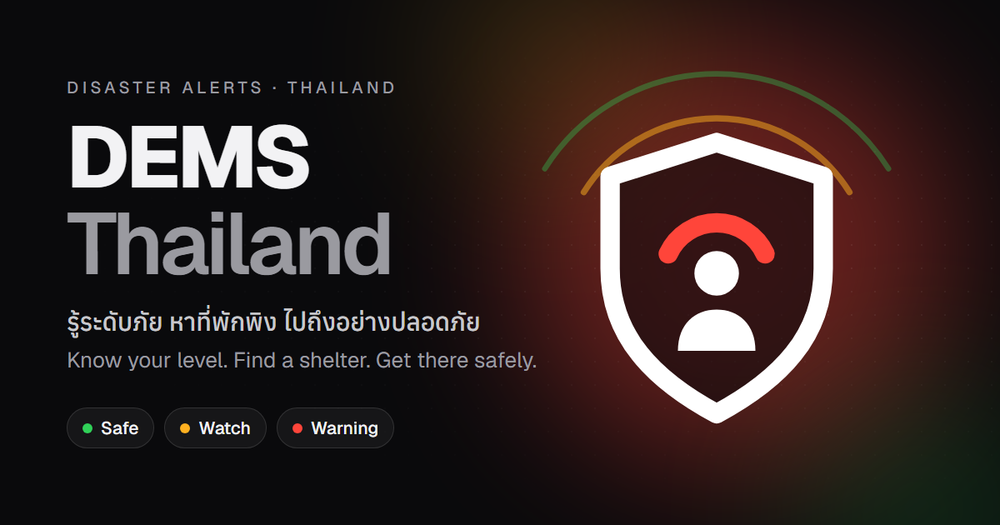

# DEMS Thailand: Disaster and Emergency Management System



A mobile-first web app that tells people in Thailand how safe their location is right now, where the nearest shelter is, and how to get there.

- Live app: https://thailand-dems.vercel.app
- Demo tour: https://thailand-dems.vercel.app/demo

> **This is a student project, not an official warning service.** Levels are estimates computed from public data. Shelters, sample disasters and evacuation routes are sample data. Always follow TMD and DDPM, and call 1784 in an emergency.

## What it does (citizens)

- **Your level:** Safe, Watch, Warning or Unknown for your location (or a place you pick).
- **Hazard map:** live hazards near you on a MapLibre map (OpenFreeMap tiles).
- **Shelters:** a list and map of shelters, with distance and capacity.
- **Safe routes:** walking, driving or cycling directions to a shelter that steer around known danger zones (openrouteservice).
- **Prepare:** a guide for each emergency type, plus a go-bag checklist and emergency numbers.
- **Report an incident:** send a short report (type, severity, description, location). It goes to the demo database only; no authority sees it.
- **English and ไทย:** the whole UI is translated. The Thai text is a draft awaiting native review, see [`web/messages/TH_REVIEW.md`](web/messages/TH_REVIEW.md).

Admin and volunteer consoles exist as **sign-in only** for now (Supabase Auth, invite-only accounts). After login you see your email and a "coming in Phase 2 / Phase 3" note. The real tools are not built yet.

## How levels work

Each hazard near you is rated Safe, Watch or Warning from public thresholds (values from [`web/src/lib/levels.ts`](web/src/lib/levels.ts)):

| Hazard | Watch | Warning | Source |
|---|---|---|---|
| PM2.5 air | above 37.5 µg/m³ | above 75 µg/m³ | Open-Meteo (Thai PCD bands) |
| Heat (feels-like, today) | 41 °C or more | 54 °C or more | Open-Meteo |
| Rain (today) | 35 mm or more | 90 mm or more | Open-Meteo (TMD bands) |
| Earthquake, within 300 km, last 24 h | M4.5 or more | M6 or more | USGS |
| GDACS event, within 300 km (cyclones 500 km) | orange | red | GDACS |
| River model rising | yes (Watch only, it is a forecast) | never | Open-Meteo |

- **The worst live hazard sets your level.**
- **Unknown, never Safe, when data is missing:** if every live feed fails, the level is Unknown.
- **Stale after 3 hours:** an old result turns Unknown on its own.
- Sample disasters from the database are shown with a Sample tag and never change your level.

## Real vs sample data

| Real (live public sources) | Sample (this demo's own database) |
|---|---|
| Weather, air quality, river forecast: Open-Meteo | Shelters and their capacity |
| Disaster alerts: GDACS | Disasters and alerts stored in the database |
| Earthquakes: USGS | Evacuation routes |
| Map tiles: OpenFreeMap / OpenStreetMap | |
| Walking, driving, cycling routes: openrouteservice | |

## Tech stack

| Layer | What |
|---|---|
| Frontend | SvelteKit 2 / Svelte 5, TypeScript 6, Tailwind CSS 4, Paraglide (i18n), MapLibre GL 6 with OpenFreeMap tiles, bits-ui, Lucide icons |
| Backend | SvelteKit server routes in `web/src/routes/api`, run on Vercel (Tokyo, `hnd1`) |
| Data | Supabase Postgres (Tokyo) with row-level security, Supabase Auth, `postgres.js` |
| Testing | Vitest, Playwright + axe (accessibility), GitHub Actions |

## Project structure

```
web/                    the app (Vercel Root Directory)
  src/routes/           pages and the /api endpoints
  src/lib/              levels, sources (Open-Meteo, USGS, GDACS), components, sample data
  src/lib/server/       database, auth, rate limiting, routing (server only)
  supabase/migrations/  SQL schema, triggers and fixes
  scripts/db/           database helper scripts
  tests/e2e/            Playwright browser tests
  messages/             English and Thai strings
demo-video/             Remotion project that renders the demo video (arrives with PR #5)
docs/superpowers/       design specs and implementation plans
.github/workflows/      CI
```

## Run it locally

You need Node 24.

```bash
cd web
cp .env.example .env     # then fill in your own values
npm ci
npm run dev              # http://localhost:3001
```

Environment variables (names only):

| Name | Used for |
|---|---|
| `PUBLIC_SUPABASE_URL` | Supabase project URL |
| `PUBLIC_SUPABASE_PUBLISHABLE_KEY` | browser-safe Supabase key |
| `SUPABASE_SECRET_KEY` | server-only Supabase key (never expose it) |
| `DATABASE_URL` | Postgres connection string (transaction pooler) |
| `ORS_API_KEY` | openrouteservice key for safe routes |

Without a database the app still opens: shelters, disasters, alerts and evacuation routes fall back to bundled sample data and an offline banner is shown. Live hazard levels use public feeds and do not need the database. Safe routes need `ORS_API_KEY`; saving reports and signing in need Supabase.

Database scripts (run from `web/`, they read `web/.env`):

| Command | Does |
|---|---|
| `npm run db:apply` | apply the SQL in `supabase/migrations` |
| `npm run db:create-admin` | create an admin sign-in |
| `npm run db:volunteers` | create volunteer sign-ins |
| `npm run db:smoke` | check the live database against the expected tables |

## Tests

Run from `web/`:

```bash
npm run check          # i18n compile + svelte-check (types)
npm test               # Vitest unit tests
npx playwright test    # browser tests + accessibility checks
```

GitHub Actions runs `check` and `test` on every pull request and every push to `main`. The browser tests run locally.

## Deploy

Vercel builds `web/` and deploys `main` to production. Every pull request gets a preview URL. Environment variables live in the Vercel project settings. Database changes are applied with `npm run db:apply`.

## History

DEMS began as an Express + MySQL API with a separate Next.js frontend. It was rebuilt as one SvelteKit app on Supabase, and the old code is preserved at the tag [`legacy-express-mysql`](https://github.com/phonesett10401/thailand-dems/tree/legacy-express-mysql). After that the citizen UI was redesigned (dark, high contrast).

## Credits and licences

- Map data: OpenStreetMap contributors (ODbL); tiles from OpenFreeMap / OpenMapTiles
- Data and services: Open-Meteo, USGS, GDACS, openrouteservice (HeiGIT)
- Fonts: Geist, Anuphan
- Demo music: "Background Technology Theme" by The_Mountain (Pixabay)

This repository has no LICENSE file yet.

## How it was built

I built this with Claude Code, an AI coding agent. I directed the product and design decisions. Sonnet subagents implemented from written specs and plans, Opus reviewed each task, and every change went through tests and a pull request. The specs and plans are in [`docs/superpowers/`](docs/superpowers/).
